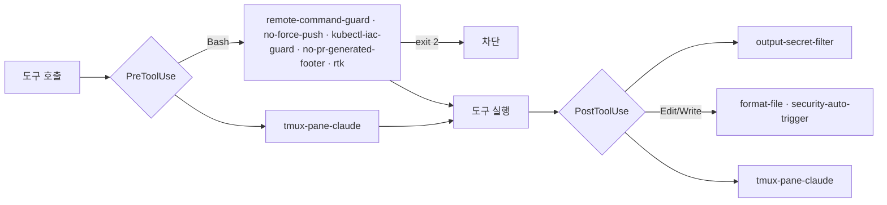
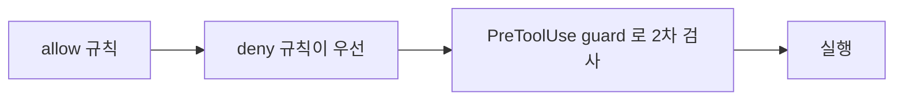

# Claude Code Configuration

[Claude Code](https://code.claude.com/docs) 글로벌 설정입니다. 모든 프로젝트에 공통으로 적용되는 기반이고,
프로젝트에만 필요한 규칙·Agent·Skill·Hook 은 각 저장소의 `.claude/` 에 둡니다. 새 프로젝트는 `/project-setup <경로>` 로 두 범위를 대조합니다.

## Setup

```sh
cd ~/.dotfiles
stow claude   # ~/.claude/{CLAUDE.md,settings.json,agents,skills,hooks,rules,references} → symlink
```

- `~/.claude/RTK.md`, `~/.claude/settings.local.json` 은 dotfiles 밖의 실제 파일입니다. 회사 정보(org·내부 도메인·버킷)와 `autoMode` 는 `settings.local.json` 에 둡니다 (이 저장소는 public).

## Directory Structure

```
.claude/
├── CLAUDE.md        # 글로벌 행동 규칙 (상시 로드)
├── settings.json    # 권한, hooks, plugin, 모델 설정
├── agents/          # 서브에이전트 정의 (.md)
├── skills/          # Workflow (SKILL.md, 호출할 때 로드)
├── hooks/           # hook 스크립트
├── rules/           # 코드 규칙 (언어 규칙은 paths: 로 해당 파일을 다룰 때만 로드)
└── references/      # Agent 가 필요할 때 읽는 참조 문서
```

## Skills (11개)

`skills/<name>/SKILL.md`. `/name` 으로 부르거나, `disable-model-invocation` 이 없으면 모델이 description 을 보고 부릅니다.

| Skill                      | 호출 | 용도                                                                                               |
| -------------------------- | ---- | -------------------------------------------------------------------------------------------------- |
| `design-doc`               | 자동 | `docs/design/**` 설계 문서 작성·정리 (frontmatter hook 으로 저장 시 `doc_lint.py`)                 |
| `github-pr-review`         | 자동 | PR 변경 파악·코드 리뷰                                                                             |
| `github-pr-respond`        | 자동 | PR 리뷰 코멘트 순차 반영·답변                                                                      |
| `github-ship`              | 자동 | branch → commit → push/PR → review → merge                                                         |
| `multi-session`            | 자동 | orchestrator·design·worker 세션 조율 (프로젝트 `.claude/references/multi-session.md` 를 함께 읽음) |
| `tracing-system-internals` | 자동 | 낯선 코드베이스의 호출 경로·설정 출처 파악                                                         |
| `write`                    | 자동 | 블로그·기술 문서 작성                                                                              |
| `learn`                    | 명시 | 끝난 세션에서 학습 내용 추출                                                                       |
| `obsidian`                 | 명시 | Obsidian vault 노트 생성·정리                                                                      |
| `prd`                      | 명시 | PRD 분석 → 설계 문서                                                                               |
| `project-setup`            | 명시 | 프로젝트 설정을 전역과 대조해 분류표 + diff 초안 (파일은 바꾸지 않음)                              |

## Agents (7개)

`agents/<name>.md`. Skill 에서 dispatch 하거나 `Agent` tool 의 `subagent_type` 으로 부릅니다.

| Agent               | model · effort  | 용도                                                                             |
| ------------------- | --------------- | -------------------------------------------------------------------------------- |
| `architect`         | opus · high     | 설계 결정, 근본 원인 진단                                                        |
| `code-reviewer`     | opus · high     | 범용 코드 리뷰. Rust diff 면 `references/rust-review-patterns.md` 품질 절을 읽음 |
| `security-reviewer` | opus · max      | 보안 취약점 리뷰. Rust diff 면 같은 파일의 보안 절을 읽음                        |
| `database-reviewer` | opus · high     | 스키마·쿼리·마이그레이션 리뷰                                                    |
| `pm-code-agent`     | opus · high     | 코드 작업 spec 규모 판단·PR 분리                                                 |
| `pm-write-agent`    | sonnet · medium | 글 주제 범위 판단                                                                |
| `github-ship`       | sonnet · medium | ship 파이프라인 실행                                                             |

- 프로젝트 전용 reviewer(예: 언어·인프라별 사고 이력 체크리스트)는 프로젝트 `.claude/agents/` 에 두고, 일반 버그·설계·테스트는 이 `code-reviewer` 몫으로 나눕니다.

## Hooks



| Hook                     | 이벤트                        | 동작                                                                                       |
| ------------------------ | ----------------------------- | ------------------------------------------------------------------------------------------ |
| `remote-command-guard`   | PreToolUse Bash               | 위험 명령 7개 범주 차단. 실패 시 막음(`onFailure: block`)                                  |
| `no-force-push`          | PreToolUse Bash               | git force push 차단. 실패 시 막음                                                          |
| `kubectl-iac-guard`      | PreToolUse Bash (`*kubectl*`) | `gke_*` context 에서 조회 외 kubectl 차단. 실패 시 막음                                    |
| `no-pr-generated-footer` | PreToolUse Bash (`*gh *`)     | PR 본문의 `Generated with` 줄 차단. 실패 시 막음                                           |
| `rtk hook claude`        | PreToolUse Bash, SessionStart | 명령 출력 압축(rtk)                                                                        |
| `output-secret-filter`   | PostToolUse 전체              | `tool_response` 의 시크릿을 `updatedToolOutput` 으로 마스킹, `~/.claude/security.log` 기록 |
| `format-file`            | PostToolUse Edit\|Write       | 프로젝트 포매터 실행                                                                       |
| `security-auto-trigger`  | PostToolUse Edit\|Write       | 보안 관련 파일 수정 시 리뷰 권고                                                           |
| `work-session-title`     | UserPromptSubmit              | 작업 세션 이름 지정                                                                        |
| `tmux-pane-claude`       | 11개 이벤트                   | tmux pane 에 세션 ID·상태·활동·agent 수 기록 (테두리·제목줄 표시, `prefix + C-r` 재시작)   |

- `design-doc` lint hook 은 `design-doc` Skill frontmatter 에, Hugo 빌드 검사는 블로그 저장소 `.claude/settings.json` 에 있습니다.

### remote-command-guard 범주

1. 파괴적 삭제 — `rm -rf`, `mkfs`, `dd`, fork bomb
2. 시크릿 유출 — `env`, `printenv`, `echo $SECRET_*`, `cat .env`
3. 경로 순회 — `/etc/passwd`, `/proc/self/`
4. 외부 통신 — `curl`, `wget`, `nc`, `ssh` (모든 호스트가 localhost 인 curl 만 예외)
5. 권한 변경 — `chmod 777`, `chown`, `sudo`, `mount`
6. 프로세스 종료 — `kill -9`, `pkill`, `shutdown`
7. 명령 주입 — `eval`, `exec`, `| sh`, `base64 -d | bash`

- 명령 이름은 명령 위치(줄 맨 앞, `; & | ( )`·줄바꿈 뒤, `$(`·backtick 안)에서만 맞춥니다. 따옴표 안 커밋 메시지의 단어로는 막지 않습니다.
- `bash -c`, `-exec`, `eval`, `xargs` 처럼 안쪽 명령을 실행하는 구조가 있으면 문자열 전체에서 맞춥니다. `env`·`timeout`·`nice`·`doas` 는 건너뛰고 실제 명령을 봅니다.

## Permission 모델



- deny 는 allow·autoMode allow 보다 우선합니다. deny 와 겹치는 autoMode allow 는 동작하지 않습니다.

## Rules (6개)

| 파일                 | 로드                    | 내용                                                              |
| -------------------- | ----------------------- | ----------------------------------------------------------------- |
| `code-principles.md` | 상시                    | fail-fast, Optional 분기 금지, 접근 제어, Stepdown, 단순화 우선   |
| `external-tools.md`  | 상시                    | gh·jira·notion CLI, 셸 명령 제약                                  |
| `go.md`              | `**/*.go`               | `Get` 접두사 금지, 패키지 경계에서 에러 맥락, `panic` 제한        |
| `rust.md`            | `**/*.rs`               | `Result`+`?`, `expect` 는 불변식 메시지와 함께, Go 와 짝지은 설명 |
| `python.md`          | `**/*.{py,pyi}`         | namespace package 우선, `_` 비공개, 타입 힌트                     |
| `typescript.md`      | `**/*.{ts,tsx,mts,cts}` | 중괄호 필수, 기존 방식 우선 후 literal union·`as const`           |

## Plugins (16개)

`superpowers`, `claude-md-management`, `claude-hud`, `hookify`, `skill-creator`, `serena`, `context7`, `playwright`, `security-guidance`, `frontend-design`, `learning-output-style`, LSP(`pyright`, `typescript`, `rust-analyzer`, `gopls`, `swift`)

## 커스터마이징

- **Skill 추가**: `skills/<name>/SKILL.md`. 명시 호출만 허용하려면 `disable-model-invocation: true`. Skill 범위 hook 은 frontmatter `hooks:` (호출한 뒤 세션 끝까지 동작)
- **Agent 추가**: `agents/<name>.md` (`name`, `description`, `tools`, `model`, `effort`)
- **규칙 추가**: `rules/*.md`. 특정 파일에만 필요하면 frontmatter `paths:` 로 범위를 좁힘
- **권한 수정**: `settings.json` 의 `permissions.allow`/`deny`
